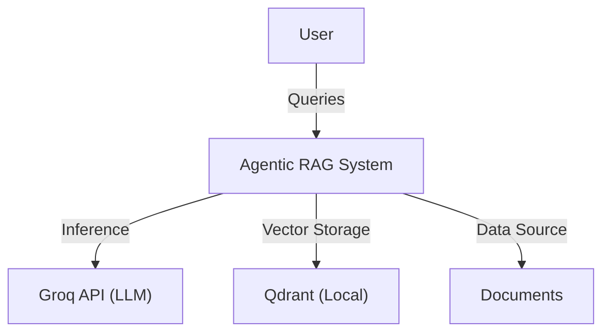
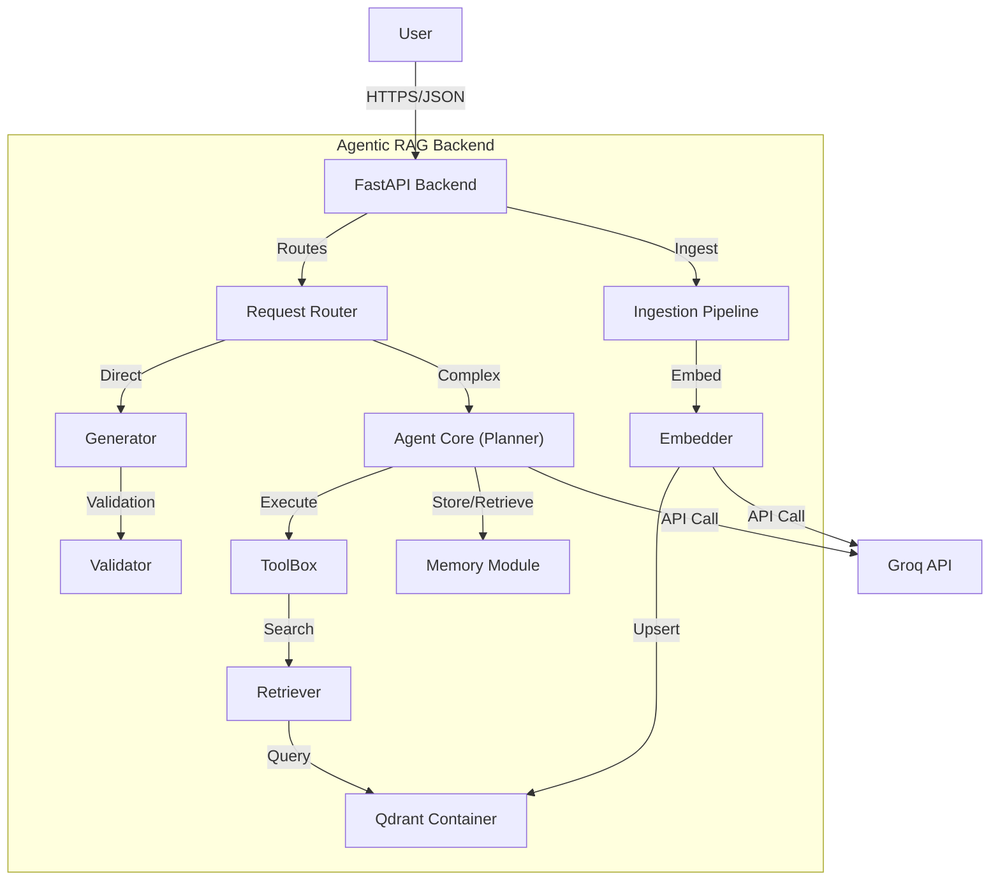
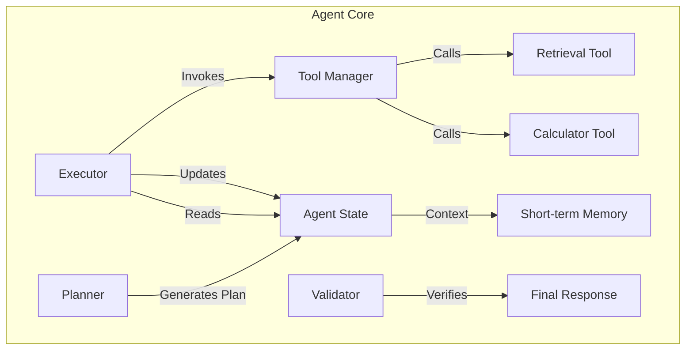

# 🏗️ ENTERPRISE ARCHITECTURE DOCUMENT

## 1️⃣ Document Metadata

| Attribute            | Value                        |
| -------------------- | ---------------------------- |
| System Name          | Agentic RAG System           |
| Architecture Version | 1.0                          |
| Based on PRD Version | 1.0                          |
| Status               | Draft                        |
| Author               | Antigravity AI Architect     |
| Reviewers            | Eng Lead / Security / DevOps |
| Last Updated         | 2026-02-12                   |

---

## 2️⃣ Architectural Vision & Strategy

-   **Architectural Style:** **Modular Monolith with Agentic Capabilities**.
    -   *Rationale:* We chose a modular monolith to simplify deployment and reduce latency overhead for the initial release. The "Agentic" aspect introduces a dynamic control flow where the system reasons about steps rather than following a rigid pipeline.
-   **System Constraints:**
    -   Self-hosted Vector DB (Qdrant).
    -   Usage of Groq API for high-speed inference.
    -   Python/FastAPI backend.
-   **Key Architectural Principles:**
    -   **Loose Coupling:** The Planner, Tools, and Memory modules are decoupled interfaces.
    -   **Observability First:** Every step of the agent's thought process is logged and traceable.
    -   **Safety & Validation:** Outputs are strictly validated against sources to prevent hallucinations.
-   **Trade-offs Accepted:**
    -   *Complexity vs. Latency:* The agentic loop adds latency compared to simple RAG, but provides significantly higher accuracy for complex queries. We accept this trade-off.
    -   *Consistency vs. Availability:* For the Vector DB, we prioritize consistency of retrieved data.

---

## 3️⃣ C4 Model

### 3.1 C4 Level 1 — System Context



### 3.2 C4 Level 2 — Container Diagram



### 3.3 C4 Level 3 — Component Diagram (Agent Core)



---

## 4️⃣ Key Technical Decisions (ADR)

### ADR-001: Usage of Qdrant as Vector Store
-   **Context:** Need a performant, self-hostable vector database.
-   **Decision:** Use **Qdrant**.
-   **Consequences:** Requires local storage management but offers high performance and rich metadata filtering without external cloud dependencies.

### ADR-002: ReAct Agent Pattern
-   **Context:** Simple RAG fails on multi-hop queries.
-   **Decision:** Implement **ReAct (Reasoning + Acting)** loop.
-   **Consequences:** Higher token usage and latency per query, but enables solving complex logical problems.

### ADR-003: FastAPI for Backend
-   **Context:** High-performance async Python framework needed.
-   **Decision:** Use **FastAPI**.
-   **Consequences:** First-class support for async/await, Pydantic validation, and auto-generated docs (OpenAPI).

---

## 5️⃣ Data Architecture

### 5.1 Qdrant Schema
-   **Collection Name:** `knowledge_base`
-   **Vector Size:** 1024 (depending on embedding model)
-   **Distance Metric:** Cosine
-   **Payload Schema:**
    ```json
    {
      "text": "Chunk content...",
      "source": "filename.pdf",
      "page": 12,
      "metadata": { "category": "finance", "date": "2024-01-01" }
    }
    ```

### 5.2 Application State
-   **AgentState:**
    -   Managed in-memory during the request lifecycle.
    -   Persisted to Qdrant (Long-term memory) upon session completion.

---

## 6️⃣ Security Architecture

-   **Authentication:** API Key header `X-API-Key` required for all endpoints.
-   **Input Validation:** All inputs strictly validated using Pydantic models.
-   **Prompt Injection:**
    -   System prompts explicitly delimit user input.
    -   "Ignore previous instructions" patterns are monitored.
-   **Secrets Management:** 
    -   `GROQ_API_KEY`, `QDRANT_API_KEY` stored in `.env` (local) or Secrets Manager (prod).
    -   Never committed to git.

---

## 7️⃣ Operational Excellence

### 7.1 Scaling
-   **Stateless Services:** The FastAPI app is stateless and can be scaled horizontally behind a load balancer.
-   **Vector DB:** Qdrant supports distributed deployment if data volume exceeds single node capacity.

### 7.2 Failure Handling
-   **Circuit Breakers:** Implemented for Groq API to fail fast during outages.
-   **Retries:** 3 retries with exponential backoff for transient network errors.
-   **Fallback:** If retrieval fails, gracefully degrade to "I don't know" rather than hallucinating.

---

## 8️⃣ Cross-Cutting Concerns

-   **Logging:** JSON-structured logs with correlation IDs.
-   **Testing:** 
    -   Unit tests for individual components (tools, utils).
    -   Integration tests for the full agent loop using mocked LLM responses.
    -   E2E tests against a local Qdrant instance.
