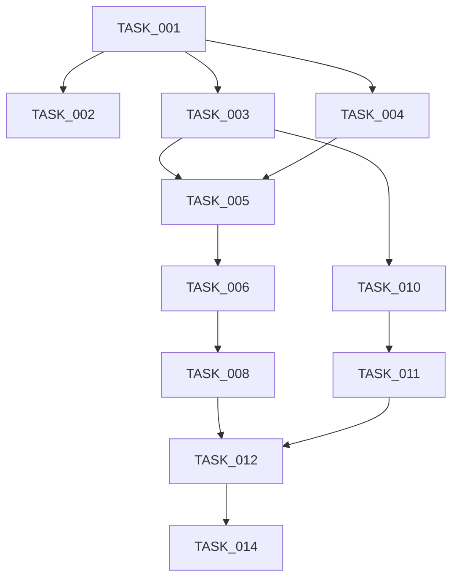

# 1️⃣ TASK_PLAN.md

## 1. Overview

- **System Name:** Agentic RAG System
- **Based on PRD Version:** 1.0
- **Based on Architecture Version:** 1.0
- **Total Task Count:** 25
- **Estimated Development Phases:** 6
- **Architecture Components Covered:** All (Backend, Data, Agent, API, Security)

---

## 2. Development Phases

### Phase 1 — Core Infrastructure & Environment
*   **Objectives:** Set up the repo, dependencies, and core utilities (logging, settings, API clients).
*   **Architecture Sections:** 2 (Vision), 4 (ADR), 5 (Folder Structure).
*   **Deliverables:** Functional `settings`, `logging`, `groq_client`, and running Qdrant instance.
*   **Exit Criteria:** Can connect to Groq and Qdrant; logs are structured.

### Phase 2 — Data Layer & Ingestion
*   **Objectives:** Implement document processing and vector storage.
*   **Architecture Sections:** 5.1 (Qdrant Schema), 4.2 (Ingestion Flow).
*   **Deliverables:** `qdrant_client`, `embedder`, `ingestion` pipeline.
*   **Exit Criteria:** Documents can be ingested and queried in Qdrant.

### Phase 3 — Retrieval Engine
*   **Objectives:** Build the retrieval logic, including semantic search and reranking.
*   **Architecture Sections:** 3.2 (Container Diagram - Retriever), 2.2 (Retrieval & Memory).
*   **Deliverables:** `retriever`, `reranker`.
*   **Exit Criteria:** Accurate retrieval of relevant chunks for a given query.

### Phase 4 — Agent Core
*   **Objectives:** Implement the ReAct agent loop, planner, and state management.
*   **Architecture Sections:** 3.3 (Component Diagram - Agent Core), 4.1 (Online Query Flow), 5.2 (Application State).
*   **Deliverables:** `planner`, `executor`, `state`.
*   **Exit Criteria:** Agent function can reason and plan steps (even with mock tools).

### Phase 5 — Tools, Memory & Validation
*   **Objectives:** Implement concrete tools, memory management, and response validation.
*   **Architecture Sections:** 3.3 (Component Diagram), 2.1 (Core Capabilities), 6 (Security).
*   **Deliverables:** `tools/*`, `memory/*`, `validator`.
*   **Exit Criteria:** Full agent loop with memory and validated outputs.

### Phase 6 — API Layer & Production Readiness
*   **Objectives:** Expose functionality via API, secure endpoints, and finalize documentation.
*   **Architecture Sections:** 3.2 (Container Diagram - API), 6 (Security), 7 (Operational Excellence).
*   **Deliverables:** `api/routes/*`, `main.py`, `README.md`.
*   **Exit Criteria:** Fully functional API accepting requests and returning validated responses.

---

## 3. Critical Path Analysis

### Critical Path
1.  **TASK_001 (Env Setup)**: Prerequisite for all code.
2.  **TASK_003 (Groq Client)**: Required for embedding and agent reasoning.
3.  **TASK_004 (Qdrant Client)**: Required for all storage/retrieval.
4.  **TASK_006 (Ingestion)**: Must exist to have data to retrieve.
5.  **TASK_008 (Retriever)**: Core dependency for the Agent.
6.  **TASK_010 (Agent Core)**: The central logic engine.
7.  **TASK_014 (API Routes)**: The interface for consumption.

*   **Delays:** If `qdrant_client` or `groq_client` are delayed, both Ingestion (Phase 2) and Agent (Phase 4) are blocked.
*   **High Risk:** `TASK_010 (Agent Core)` is the most complex logic; likely to require iteration.

---

## 4. Task Summary Table

| Task ID | Title | Phase | Complexity | Dependencies | Critical |
| :--- | :--- | :--- | :--- | :--- | :--- |
| **TASK_001** | Environment Setup & Project Structure | 1 | S | None | Yes |
| **TASK_002** | Core Configuration & Logging | 1 | S | TASK_001 | Yes |
| **TASK_003** | Groq Client Implementation | 1 | M | TASK_002 | Yes |
| **TASK_004** | Qdrant Client Wrapper | 2 | M | TASK_002 | Yes |
| **TASK_005** | Embedding Service | 2 | S | TASK_003 | Yes |
| **TASK_006** | Ingestion Pipeline (Loader/Chunker) | 2 | L | TASK_004, TASK_005 | Yes |
| **TASK_007** | Ingestion API Endpoint | 6 | S | TASK_006 | No |
| **TASK_008** | Retrieval Engine (Sem Search) | 3 | M | TASK_004, TASK_005 | Yes |
| **TASK_009** | Reranking Module | 3 | M | TASK_008 | No |
| **TASK_010** | Agent State & Planner | 4 | L | TASK_003 | Yes |
| **TASK_011** | Tool Interface & Basic Tools | 5 | M | TASK_010 | Yes |
| **TASK_012** | Agent Executor (Loop) | 4 | XL | TASK_010, TASK_011 | Yes |
| **TASK_013** | Memory Module (Short & Long Term) | 5 | L | TASK_004, TASK_012 | Yes |
| **TASK_014** | API Routes (Query & Chat) | 6 | M | TASK_012, TASK_013 | Yes |
| **TASK_015** | Validator & Guardrails | 5 | M | TASK_012 | No |
| **TASK_016** | System Prompts Management | 4 | S | None | No |

---

## 5. Architecture Coverage Validation

-   **Backend/App**: Checks TASK_001, TASK_002, TASK_014.
-   **Backend/Retrieval**: Checks TASK_004, TASK_005, TASK_008, TASK_009.
-   **Backend/Ingestion**: Checks TASK_006, TASK_007.
-   **Backend/Agent**: Checks TASK_010, TASK_012, TASK_016.
-   **Backend/Tools**: Checks TASK_011.
-   **Backend/Memory**: Checks TASK_013.
-   **Backend/Security**: Checks TASK_015, TASK_002.
